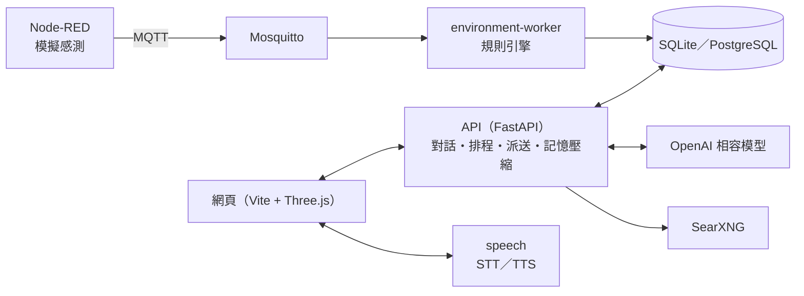

# MEMO：會自己觀察空間的桌上小夥伴

MEMO 會自己觀察這個空間、理解發生了什麼，並在值得的時候回報。它用鏡頭看有沒有人、有沒有動物、東西有沒有被動，用感測器讀取溫度、濕度、CO₂ 與光照，再由規則引擎判斷要不要說。你可以指派它顧東西、定時回報；也可以跟它閒聊。它的個性天真、有自己的小邏輯、偶爾吐槽，但會陪你一起做事。它也能設定提醒、上網查資料，並用語音說話與聆聽。網頁上有一個 3D 的 MEMO，旁邊放著一盞小檯燈。

**核心原則**：規則引擎決定「該不該說、多嚴重」；模型負責看懂畫面、決定「怎麼說」。模型慢或失敗時，提醒照樣送出，改用模板文字。照片不保存。

## 功能

| 類別 | 內容 |
| --- | --- |
| 環境感測 | 溫度、濕度、CO₂、光照（lux）；MQTT 或 HTTP 輸入，逐一驗證每個指標 |
| 規則引擎 | 持續時間、遲滯、嚴重程度（注意／警戒／危險）、體感溫度、趨勢；沒有新資料也會發現感測中斷；門檻可線上修改 |
| 主動提醒 | 升級、重複提醒、延後、勿擾時段、每小時上限；網頁沒開時，回來後用一兩句補說錯過的事 |
| 對話 | 可設定人格；OpenAI 相容模型（實測 Gemma 4），失敗時用模板備援 |
| 排程任務 | 用說的設定單次、定期、每日提醒，以及「我開窗了」之後的追蹤回報 |
| 上網搜尋 | 自架 SearXNG，免費、免金鑰；回答附資料來源 |
| 看圖片 | 上傳或貼上一張圖給 MEMO 看；圖片不保存 |
| 觀察 | 鏡頭開著就一直在觀察：畫面變了、有人來去、每 15 分鐘巡視時看一眼，記下人、動物、事、地、物、動作與畫面品質；有人回來、動物出現時才說話，其他寫進觀察日誌。沒人時環境小事只記錄 |
| 指派與互動 | 「幫我顧著箱子」（持續盯著，被動了馬上說）、「每 30 分鐘告訴我這邊的情況」（畫面＋環境）、「現在這邊怎樣」「今天有誰來過」都根據紀錄回報；日常聊天則人格優先 |
| 鏡頭互動 | 眼睛跟著你、螢幕表情回應你的表情、待機時對你揮手；「我手上拿的是什麼」會倒數拍照並解釋或翻譯。照片不保存（見 [MEMO 的眼睛](docs/vision.md)） |
| 語音 | 本機 SenseVoice 辨識、Kokoro 合成，只用 CPU |
| 記憶 | 60 分鐘沒說話就算新的一次對話；舊對話自動壓縮成摘要；長期記得「關於你的事」（稱呼、喜好、正在做的作品） |
| 網頁 | 3D MEMO 與表情、環境監控、鏡頭（現在看到的與觀察日誌、拍照任務）、檯燈、人格設定、環境干擾 |

## 架構



| 服務 | 網址 | 用途 |
| --- | --- | --- |
| 網頁 | http://127.0.0.1:5173 | MEMO 3D 介面（本機用 Vite 啟動） |
| API | http://localhost:8000/docs | REST API 與 Swagger |
| Node-RED | http://localhost:1880 | 每 5 秒送出模擬感測資料，提供環境干擾 |
| 語音 | http://localhost:8001 | 語音辨識與合成 |
| SearXNG | http://localhost:8080 | 自架搜尋（只給 API 用） |
| MQTT | localhost:1883 | Mosquitto broker |

完整流程（輸入、規則、提醒、提示組裝、模型、記憶）見 [LLM 架構](docs/llm-architecture.md)。

## 快速開始

需要 Docker（Docker Desktop，或 WSL 內的 Docker Engine，見 [WSL Docker 操作](docs/docker-wsl.md)）與 Node.js。

**1. 設定模型**：複製 `.env.example` 為 `.env`，填入模型連線。不填也能跑，MEMO 會用模板回覆。

```dotenv
OPENAI_BASE_URL=https://你的端點/v1
OPENAI_API_KEY=你的金鑰
OPENAI_MODEL=模型名稱
# Gemma 4（BIRC-LLM）實測需要：
OPENAI_REASONING_EFFORT=none
OPENAI_SYSTEM_ROLE=false
OPENAI_JSON_MODE=false
```

**2. 啟動後端**（第一次會建置映像，語音模型約 1.6 GB）：

```powershell
docker compose up -d --build --wait
```

API 啟動時會自動執行資料庫 migration；Node-RED 啟動後就開始送資料。

**3. 啟動網頁**：

```powershell
cd memo_demo
npm ci
Copy-Item .env.example .env.local   # 預設指向 localhost 的 API、Node-RED、語音
npm run dev
```

打開 http://127.0.0.1:5173。第一次 `npm run dev` 會下載臉部與手部的 MediaPipe 模型（約 11 MB，檢查 SHA-256）到 `public/mediapipe/`；鏡頭要在 `localhost` 或 HTTPS 下才能用。

**停止**：`docker compose stop`（保留資料），再開用 `docker compose start`。

> WSL 內的 Docker：沒有開著的 WSL 終端時，WSL 可能會閒置關機，容器跟著停止。要長時間運作，請開著一個 Ubuntu 終端。

## 設定

完整清單見 [.env.example](.env.example)。常用的：

| 變數 | 預設 | 說明 |
| --- | --- | --- |
| `OPENAI_BASE_URL`／`OPENAI_API_KEY`／`OPENAI_MODEL` | — | OpenAI Chat Completions 相容端點；沒填模型就用模板 |
| `OPENAI_TIMEOUT_SECONDS` | 30 | 逾時就改用模板 |
| `OPENAI_REASONING_EFFORT`／`OPENAI_MAX_COMPLETION_TOKENS` | — | 選填，設定才會送出 |
| `OPENAI_SYSTEM_ROLE`／`OPENAI_JSON_MODE` | true | 模型不理會 system 角色或 JSON 模式時設 `false` |
| `OPENAI_VISION` | true | 模型不支援圖片時設 `false` |
| `OPENAI_VISION_TIMEOUT_SECONDS`／`LOOK_NOTICE_TIMEOUT_SECONDS` | 8／5 | 拍照任務每張照片的分析時間、通知的說話時間 |
| `SEARCH_URL` | — | SearXNG 位址；Compose 內自動設定 |
| `TIMEZONE` | Asia/Taipei | 每日排程與勿擾時段 |
| `QUIET_HOURS` | — | 例如 `23:00-07:00`，期間只有危險等級會說 |
| `MAX_PROACTIVE_PER_HOUR` | 6 | 每小時主動提醒上限（危險不計） |
| `DATABASE_URL` | `sqlite:///./memo.db` | 本機資料庫；Compose 使用 volume 內的 `/data/memo.db` |
| `CORS_ORIGINS` | 本機網頁 | 可呼叫 API 的網頁來源（JSON 陣列） |

勿擾時段、每小時上限與人格也可以每個裝置分開設定（`PUT /api/v1/devices/{id}/settings`）；規則門檻可用 `PUT /api/v1/rules/{id}` 修改，都不需要重啟。API key 只放後端，網頁的 `VITE_*` 變數會公開，不要放金鑰。

## 本機開發

需要 Python 3.11+ 與 [uv](https://docs.astral.sh/uv/)。不用 Docker 跑 API：

```powershell
uv sync
uv run alembic upgrade head
uv run uvicorn memo.main:create_app --factory --reload --host 127.0.0.1
```

MQTT worker 與模擬器（需要 broker）：

```powershell
uv run python -m memo.workers.environment
uv run python -m memo.workers.simulator --scenario co2-rise-recover --count 73
```

**檢查**：

```powershell
uv run pytest                 # 後端測試（使用獨立的 SQLite）
uv run ruff check .
uv run ruff format --check .
uv run alembic check
cd memo_demo; npm test             # 前端感知邏輯的單元測試（眼睛、表情、揮手）
cd memo_demo; npm run test:browser   # 瀏覽器整合測試，需要整套服務在跑
```

**專案結構**：

```text
src/memo/
├── domain/          # 純 Python：規則引擎、排程解析、記憶分段與壓縮規則
├── application/     # 對話流程、提示組裝、use cases
├── infrastructure/  # 資料庫、模型與搜尋轉接、派送器、排程器、記憶壓縮
├── presentation/    # FastAPI routes 與 schema
├── workers/         # MQTT environment-worker、模擬器
└── main.py          # 組裝依賴與背景執行緒
migrations/          # Alembic 資料庫版本
memo_demo/           # 網頁（Vite + Three.js）
speech/              # 語音服務（sherpa-onnx）
node-red/            # 預載的 Node-RED 流程
searxng/             # SearXNG 設定
docs/                # 架構與 API 文件
```

依賴方向：`presentation → application → domain`；`infrastructure` 實作 application 的介面；domain 與 application 不引用 FastAPI 或 SQLAlchemy。

## API 概覽

完整規格見 [openapi.yaml](docs/openapi.yaml) 或 Swagger。路徑前綴皆為 `/api/v1`。

| 類別 | 端點 |
| --- | --- |
| 裝置與讀值 | `POST /devices`、`GET /devices`、`POST /telemetry`、`GET /devices/{id}/readings`、`…/readings/summary`、`…/state` |
| 對話 | `POST /devices/{id}/interaction`（可附圖片）、`POST /devices/{id}/digest` |
| 主動提醒 | `GET /devices/{id}/notifications`、`POST …/notifications/ack` |
| 事件 | `GET /devices/{id}/events`、`…/events/history`、`…/events/{event_id}`、`POST …/ack`、`…/snooze`、`…/handled` |
| 排程 | `GET／POST /devices/{id}/schedules`、`PATCH／DELETE …/schedules/{job}` |
| 記憶 | `GET／DELETE /devices/{id}/memory/conversation`、`GET／PUT／DELETE …/memory/profile`、`GET …/memory/summaries` |
| 設定 | `GET／PUT /rules`、`/rules/{id}`、`/devices/{id}/settings`、`/devices/{id}/lamp` |
| 健康檢查 | `GET /health/live`、`GET /health/ready`（不在 `/api/v1` 下） |

送一筆讀值（PowerShell）：

```powershell
$reading = @{
    message_id = [guid]::NewGuid().ToString(); device_id = 'room01'; sequence = 1
    observed_at = [DateTimeOffset]::UtcNow.ToString('o')
    metrics = @{ temperature_c = 29.2; humidity_pct = 65; co2_ppm = 1100; illuminance_lux = 300 }
} | ConvertTo-Json
Invoke-RestMethod http://127.0.0.1:8000/api/v1/telemetry -Method Post -ContentType 'application/json' -Body $reading
```

資料規則：相同 `message_id` 重送回傳原資料，內容不同回 409；時間必須含時區，統一以 UTC 儲存；超出合理範圍的指標記為缺值並列在 `rejected_metrics`，其他指標照常保存；與接收時間相差超過 30 秒的補送資料只存歷史，不觸發提醒。

## 文件

| 文件 | 內容 |
| --- | --- |
| [LLM 架構](docs/llm-architecture.md) | 輸入到說話的完整流程：規則、提醒、排程、搜尋、看圖、記憶、提示、模型 |
| [執行說明](docs/companion-runtime.md) | 規則表、事件狀態、記憶分離、投遞與人格 |
| [MQTT Worker](docs/mqtt-worker.md) | 封包格式、接收流程、驗證方式 |
| [LLM 介面](docs/llm-api.md) | 無狀態的 `/llm/prepare`、`/llm/respond` |
| [WSL Docker 操作](docs/docker-wsl.md) | 在 WSL 內使用 Docker |
| [網頁](memo_demo/README.md)／[Node-RED](node-red/README.md)／[語音](speech/README.md) | 各元件的使用說明 |
| [原始規劃](environment_ai_plan.md) | 最初的架構與實作規格 |

## 升級既有安裝

- **資料庫**：本機執行 `uv run alembic upgrade head`；Docker 版由 API 啟動時自動升級。
- **Node-RED 流程**：既有的 volume 不會被新版範例覆蓋。要更新時，在編輯器刪除舊的範例分頁，再 Import [node-red/flows.json](node-red/flows.json) 並 Deploy。
- **舊的環境變數**：舊版的 `MEMO_` 前綴已移除（`MEMO_MQTT_*` 改為 `MQTT_*`，`LLM_*` 改為 `OPENAI_*`）；MQTT topic 使用 `memo/v1/`。

## 尚未完成

- 語音：BMO 風格音色（音高、句尾上揚、小喇叭效果）、英文口音、依情緒調整語調、聽出使用者的語氣情緒。
- 影像：鏡頭拍照（目前只能上傳或貼上圖片）。
- 網頁上的任務清單（暫停、刪除）；秒級提醒。
- MQTT 帳號、ACL、TLS 與裝置上下線狀態；送往實體裝置的 `commands`／`acks`。
- API 身分驗證；資料保留策略與 PostgreSQL 整合驗證。
- PM2.5、人體感測、翻譯。

目前是本機開發用的雛形，沒有身分驗證，請勿直接對外開放。
