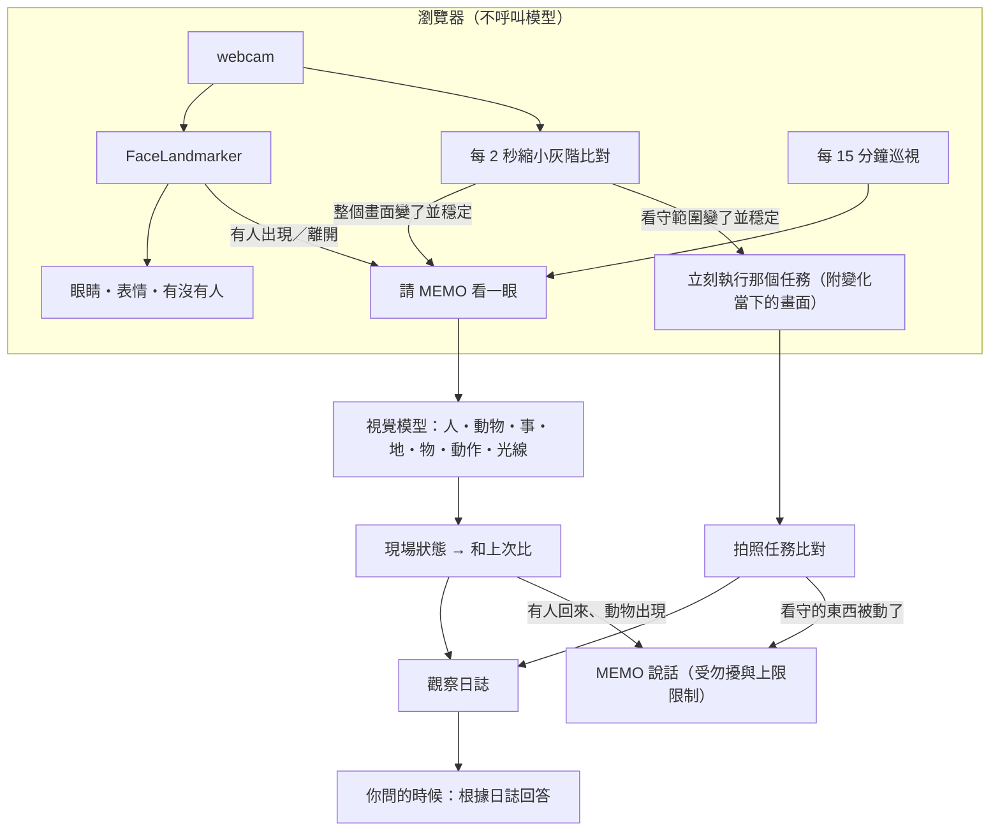

# MEMO 的眼睛：觀察、理解與回報

MEMO 會自己觀察這個空間：用鏡頭看有沒有人、有沒有動物、東西有沒有被動，用感測器感覺溫濕度、空氣和光線；理解發生了什麼，值得的時候告訴你，也能回答「現在這邊怎樣」「今天有誰來過」。平常它一樣陪你聊天、陪你一起做事。

**原則**：規則決定該不該說、多嚴重；模型負責看懂照片、決定怎麼說。照片不保存。

| 功能 | 怎麼開始 | 在哪裡算 | 會說話嗎 |
| --- | --- | --- | --- |
| 觀察這個空間 | 打開鏡頭就開始，一直在看 | 瀏覽器比對變化，有變化才請模型看 | 有人回來、有動物時說；其他只記錄 |
| 眼睛跟著你 | 打開鏡頭 | 瀏覽器（FaceLandmarker） | 不會 |
| 表情：你笑，MEMO 開心 | 打開鏡頭 | 瀏覽器（blendshape） | 不會，只換螢幕表情 |
| 揮手：MEMO 待機時揮回去 | 打開鏡頭 | 瀏覽器（HandLandmarker） | 不會 |
| 立即辨識：「我手上拿的是什麼」 | 你問 | 模型 | 會 |
| 現場回報：「現在這邊怎樣」 | 你問 | 模型＋感測器 | 會 |
| 拍照任務：顧東西、定時回報、是非題 | 你指派 | 瀏覽器＋模型 | 需要時 |

以後改成實體攝影機時，只要換掉網頁這一層（拍照、比對、回報），後端的 API、比對規則與紀錄都不用改。



## 1. 兩種對話：指派與互動

| | 指派（assignment） | 互動（interaction） |
| --- | --- | --- |
| 例子 | 「幫我顧著箱子」「每 30 分鐘告訴我這邊的情況」「現在這邊怎樣」「今天有誰來過」「現在幾度」 | 「房間好亂，不想整理」「我盯著這題半小時了」「明天要報告，救我」 |
| MEMO 怎麼答 | 先講事實（看到什麼、什麼時候、數值多少），只根據觀察紀錄、拍照任務、感測數據與照片；再用個性補一句小看法或下一步 | 人格優先，陪你一起做事；不硬塞環境或觀察內容 |
| 帶進提示的資料 | 現場狀態與今天的觀察日誌、環境數據 | 不帶（危險等級除外） |
| 網頁 | 泡泡上標「回報」 | 沒有標示 |

判斷規則在 `memo/domain/observation.py` 的 `conversation_mode`：觀察、回報、看守、詢問紀錄、問數值的說法是指派；心情（「我最近情況不太好」「好悶」）和日常閒聊是互動。設定提醒或任務的訊息一律算指派。回應的 `mode` 欄位帶著結果。

## 2. MEMO 的個性

天真、有自己的一套小邏輯，會很認真地說出有點奇怪的話；把日常小事當冒險；偶爾吐槽、帶一點二次元式的調侃，但嘴上調侃一定會幫忙，而且是陪你一起做事；被誇會得意、被嫌會鬧一下彆扭，但很快回到正事；你難過時不吐槽，先問你想說說還是想先休息。

提示裡附了五段語氣範例（「衣服山」、偷襲題目、得意八成、今天不太順、困難模式），模型只學語氣，不照抄句子。網頁上選的人格（陪伴者、損友…）疊加在這個個性之上。

## 3. 觀察這個空間

**鏡頭開著就是在觀察**，沒有另外的開關。關掉鏡頭就停止。分頁在背景時照常觀察（計時放在 Worker），臉部追蹤則暫停。

**網頁什麼時候請 MEMO 看一眼**（`POST /observe`）：

| 觸發 | 條件 |
| --- | --- |
| `patrol` 例行巡視 | 打開鏡頭時看第一眼，之後每 15 分鐘 |
| `scene_change` 畫面變了 | 每 2 秒把畫面縮成 64 像素寬的灰階，和上次看過的畫面比；差異夠大，而且連續 3 次幾乎不動（變化穩定了）。比對前會扣掉整體亮度，鏡頭自動調整曝光不算變化 |
| `person_enter`／`person_leave` | 臉連續出現 3 秒、或連續 30 秒沒出現（只在分頁看得到時） |

兩次觀察至少隔 20 秒（有人出現或離開時是 5 秒），太快的會收到 409。

**每一眼都會**：

1. 交給模型描述：一句摘要，以及情境紀錄（人、動物、事、地、物、動作、光線）。模型不從照片猜溫度或空氣，那些交給感測器。
2. 記錄在 `vision_observations`（`job_id` 為 `observe`），包含畫面品質；照片不存。
3. 更新**現場狀態**（`observation_states`）：幾個人、哪些動物、光線、摘要、時間。
4. 和上次比，產生**事件**，寫進**觀察日誌**（`observation_events`）：

| 事件 | 條件 | 會說嗎 |
| --- | --- | --- |
| `start` 開始觀察 | 第一次看 | 不會 |
| `arrival` 有人出現 | 人數從 0 變成大於 0 | 離開超過 10 分鐘才說；會順便說離開期間最值得一提的事 |
| `departure` 沒有人了 | 人數變成 0 | 不會 |
| `animal` 動物出現 | 出現上次沒有的動物種類（「一隻貓（趴在箱子上）」視為「貓」） | 會；同一種動物 30 分鐘內只說一次 |
| `animal_gone` 動物離開 | 那種動物不見了 | 不會 |
| `lights` 光線變化 | 明亮與昏暗互換 | 不會 |

物品清單不拿來比對：模型每次列出的桌上物品都不太一樣，比了只會產生雜訊。要看某個東西有沒有被動，請用看守任務（第 5 節）。

- 一張照片最多說一件事，有人回來優先。
- 勿擾時段和每小時上限照常適用：說不出來的事仍然寫在日誌裡。

**沒有人時，環境通知只記錄**：鏡頭在 10 分鐘內確定沒有人時，非危險等級的環境提醒不說出來，等你回來時用一兩句補說；危險等級一律說。鏡頭沒開或很久沒看時，當作「可能有人」，照常提醒。環境通知也會帶入現場狀態，有人在場時，提醒的對象就是在場的人。

## 4. 你問的時候

- **「現在這邊怎樣？」**：網頁馬上拍一張（不倒數，`wantsReport`），MEMO 先說照片裡看到的，再說空氣、溫濕度或光線。
- **「今天有誰來過？」「貓什麼時候來的？」「剛剛發生什麼？」**：根據今天的觀察日誌（最近 12 筆與各事件次數）回答；沒看到就直說。
- **「我手上拿的是什麼？」「幫我翻譯這個」**：倒數 3 秒拍照，先說是什麼再解釋；翻譯時「」裡寫原文，語音只念中文。關鍵字沒抓到時，模型可以回 `{"type":"look"}`，網頁拍照後再問一次。

## 5. 拍照任務（指派）

用說的，由模型產生排程動作：

```json
{"type":"schedule","kind":"interval","minutes":5,"purpose":"look","message":"箱子",
 "look":{"mode":"change","question":"桌上的箱子","watch":true}}
```

| `mode` | 用途 | 例子 |
| --- | --- | --- |
| `check` | 是非題，`alert_on` 是需要提醒的答案 | 「每 30 分鐘看我有沒有駝背」（yes）、「每天 23:00 看電腦有沒有關」（no） |
| `change` | 和基準比有沒有變化；`watch: true` 表示**持續盯著** | 「幫我顧著箱子」「有沒有人動我的東西」 |
| `report` | 描述畫面，**連同環境一起回報**，每次都說 | 「每 30 分鐘告訴我這邊的情況」 |

`notify`（check 適用）：`on_alert`（預設）、`on_change`、`always`。`roi`：只看畫面的一部分，在側欄用「框選範圍」設定。也可以用 `POST /schedules`、`PUT /schedules/{id}/look` 設定。

### 5.1 持續盯著（watch）

- **建立時立刻拍基準**；之後排程照常（例如每 5 分鐘）請模型看一次當保險。
- 網頁每 2 秒比對這個範圍（48 像素寬的灰階）：
  - 差異第一次出現（常常是一隻手伸進來）時，先拍一張「變化當下」的畫面留著。
  - 差異持續、而且畫面靜止 3 次（約 6 秒）→ `POST /schedules/{id}/trigger` 立即執行一次。
  - 手伸進來又拿走、畫面回到原樣，不算變化。
- 這次執行**不需要確認照片**（本機已經看到變化持續），模型同時拿到基準照片、現在的照片和變化當下的畫面，說明哪裡變了、當時發生什麼動作（例如「一隻手把箱子拿起來」）。
- 從箱子被動到 MEMO 說話：本機確認約 6 秒，加上模型與說話的時間。
- 看守的東西被動了是最高等級：**勿擾時段也會說**，也不受每小時上限限制。
- 只能知道「什麼時候、發生了什麼動作」，**不辨認是誰**。

### 5.2 定時看與確認

到期時，網頁拍照（`awaiting_capture`，2 分鐘內）→ 模型 → `judge()` 比對：

| 上次 → 這次 | 決定 |
| --- | --- |
| 任何 → unknown | 狀態不變；連續 3 次說一次「看不清楚」 |
| 正常 → 需要提醒 | 6 秒後的第二張也一樣才提醒（第 1 級）；第二張在第一張送出時就先拍好，不多等 |
| 持續需要提醒 | 第 4、7、10… 次再提醒，語氣升到第 2、3 級（第 3 級會問要不要暫停任務） |
| 需要提醒 → 正常 | 確認後說一次「好多了」 |
| 變化比對：第一次 | 成為基準（照片只存在瀏覽器的 IndexedDB，後端存文字描述） |
| 變化比對：有變 | 確認後說哪裡變了，這張成為新的基準 |
| report | 每次都說：先說畫面（和上次回報比的變化），再說環境 |

**勿擾時段照常拍照、照常記錄**，只有看守的東西被動了才說出來；其他的等你回來。單次的變化比對（「10 分鐘後看箱子有沒有被動」）會先立刻拍基準，到時間再比一次。

**每次執行一定留下紀錄**，包括沒拍到的原因：`camera_off`、`permission_denied`、`camera_unavailable`、`no_capture`、`no_confirmation`、`model_not_configured`、`vision_unavailable`、`model_timeout`、`model_unavailable`、`invalid_model_output`、`vision_busy`、`analysis_interrupted`。任務的發現也會寫進觀察日誌（`watched_change`、`task`），標明有沒有說出來。

## 6. 畫面品質與情境紀錄

品質在瀏覽器量（256 像素寬的灰階），**記錄，不重拍**：`dark`（平均亮度 < 45）、`overexposed`（> 220）、`low_contrast`（標準差 < 15）、`blurry`（Laplacian 變異數 < 40），另外記錄模型判斷的 `visibility`。

情境紀錄（`scene`），後端會限制長度並過濾敏感字：

| | 欄位 | 例子 |
| --- | --- | --- |
| 人 | `people.count`、`people.description` | 1、「坐在書桌前、背有點彎」（不辨認是誰） |
| 動物 | `animals`（最多 5 個） | 「一隻貓（趴在箱子上）」 |
| 事 | `activity` | 「在電腦前工作」 |
| 時 | `captured_at` | 由後端記錄 |
| 地 | `place` | 「書桌前」 |
| 物 | `objects`（最多 8 個） | 「筆電、紙箱」 |
| 動作 | `actions`（最多 5 個） | 「打字、伸手拿起箱子」 |
| 光線 | `lighting` | 「明亮」 |

## 7. 眼睛、表情與揮手

- **眼睛**：臉的中心 → 鏡像（`0.5 - x`）→ 放大 2.2 倍、6% 死區 → 平滑 → 瞳孔偏移最多 ±40／±28 像素，4 像素一格。
- **表情**：blendshape 減去你的放鬆基準 → 遲滯門檻 → 持續夠久才算。笑 → MEMO 開心；驚訝 → 驚訝；皺眉 → 關心（不學你皺眉）；疲倦（眼睛半閉 20 秒或打哈欠）→ 想睡。只換螢幕表情，不記錄、不上傳。
- **表情仲裁**：alert／error／思考／聆聽／拍照中 → 正在說話 → 回覆的表情（維持 8 秒）→ 回應你的表情（最快 1.5 秒換一次）→ MEMO 原本的表情。
- **揮手**：手掌張開、高於下巴、1.5 秒內左右來回 3 次以上；只在 MEMO 待機時揮回去（沒在回話、沒在說話、沒有倒數、2 秒內沒打字）。

## 8. 隱私

- 鏡頭預設關閉，打開後左上角一直顯示「觀察中」，拍照時閃「剛看了一眼」，背景分頁的標題前面加 📷。
- 照片只送給模型看，不保存；變化比對的基準照片只存在你的瀏覽器。
- 臉部與手部的關鍵點、比對用的灰階縮圖都不會離開瀏覽器。
- 不辨認人是誰，不推測年齡、健康、情緒或身分。家人、室友、客人入鏡時，日誌只會記「有人出現」和看得到的動作。
- 觀察日誌與照片紀錄保留 30 天，每日統計 180 天；側欄可以一鍵清除觀察日誌。
- 只能在 `localhost` 或 HTTPS 使用鏡頭。

## 9. API

| 方法 | 路徑 | 說明 |
| --- | --- | --- |
| POST | `/api/v1/devices/{id}/observe` | MEMO 自己看一眼：`{trigger, image | skip, quality?, captured_at?}` → 摘要、事件、要不要說 |
| GET | `/api/v1/devices/{id}/observation` | 現在的現場、今天各事件次數、巡視間隔 |
| GET／DELETE | `/api/v1/devices/{id}/observation/log` | 觀察日誌（合併拍照任務的發現與環境事件，新的在前）；清除 |
| GET | `/api/v1/devices/{id}/captures/pending` | 拍照任務現在要拍的照片、持續盯著的範圍 |
| POST | `/api/v1/devices/{id}/captures` | 送出任務照片或沒拍到的原因；`trigger: "watch"` 加 `moment` 是持續盯著觸發的 |
| POST | `/api/v1/devices/{id}/schedules/{job}/trigger` | 持續盯著的任務立即執行一次 |
| PUT | `/api/v1/devices/{id}/schedules/{job}/look` | 修改 `alert_on`、`notify`、`roi`、`watch` |
| GET／DELETE | `/api/v1/devices/{id}/vision/observations` | 照片紀錄（任務與 MEMO 自己看的，`job_id=observe`） |

## 10. 設定

| 變數 | 預設 | 說明 |
| --- | --- | --- |
| `OPENAI_VISION` | true | 模型不支援圖片時設 `false` |
| `OPENAI_VISION_TIMEOUT_SECONDS` | 8 | 每張照片的分析時間 |
| `LOOK_NOTICE_TIMEOUT_SECONDS` | 5 | 拍照任務與觀察通知的說話時間；逾時改用模板 |

MediaPipe 的 wasm 與模型由 `npm run dev`／`build` 前的 `scripts/vision-assets.mjs` 放到 `public/mediapipe/`（模型檢查 SHA-256）。

## 11. 測試

- `tests/test_observation.py`：動物與光線比對、事件、什麼值得說、沒人時環境通知只記錄、指派與互動的判斷、人格與兩種模式的提示、觀察流程（開始觀察、離開、動物、有人回來並補說）、節流與勿擾、聊天的模式、看守任務的立即基準與觸發（勿擾也說）、單次變化比對、report 連同環境回報、是非題在勿擾時段只記錄。
- `tests/test_vision.py`、`tests/test_vision_api.py`：任務設定、品質、情境、`judge()`、確認拍照、紀錄、取消、立即辨識、視覺模型轉接（多張圖、變化當下的畫面、report）。
- `memo_demo/tests/perception.test.mjs`（`npm test`）：眼睛、表情、揮手、表情仲裁、畫面品質、變化比對（亮度變化與手伸進又離開都不算）、關鍵字。
