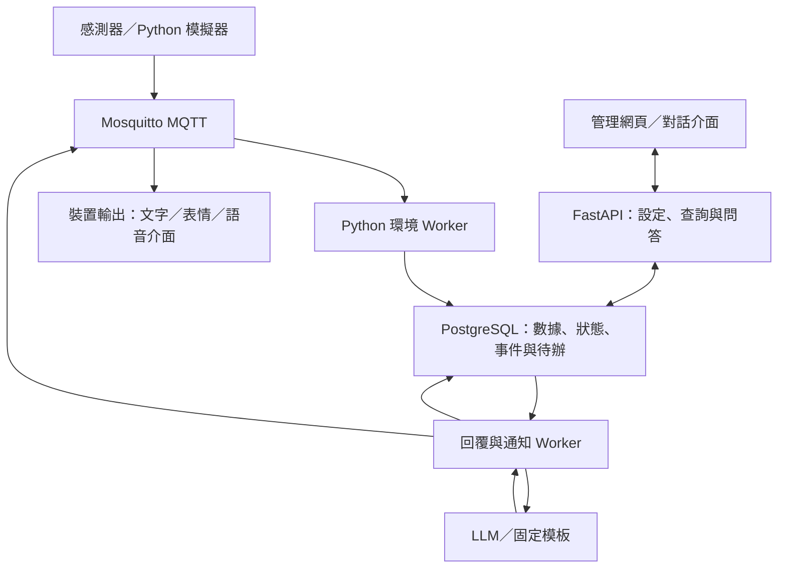

# MEMO：Python 環境事件與 AI 互動完整方案

環境感知 AI 角色名稱為 **MEMO**。

## 1. 目標與第一版範圍

建立以 Python 為核心的環境事件處理後端：接收 MQTT 感測資料，驗證品質，分析閾值、趨勢與持續時間，管理事件生命週期，再提供有依據的主動提醒及環境問答。

硬體只需依約定格式提供資料，開發與展示可先使用 Python 模擬器。第一版不需要 Node-RED 拖拉介面，保留 MQTT 協定即可讓 Node-RED 日後作為外部串接工具。

第一版完成：溫度、濕度、CO₂；MQTT 接收；資料品質；超標與趨勢；事件確認、惡化、恢復；延後與冷卻；處理後追蹤；LLM 人格回覆；歷史問答；簡單管理介面。

之後擴充：PM2.5、存在與活動感測、按需視覺、語音、翻譯、跨裝置互通。PM2.5 尚未接入前，不產生依賴室外空品資訊的具體通風決策。

## 2. 整體架構



部署採一個程式庫、多個執行入口，非拆成多套獨立產品。Docker Compose 先啟動 broker、db、api、environment-worker、interaction-worker；模擬器按需啟動。兩個 Worker 第一版各一份。

技術選擇：FastAPI + Pydantic、paho-mqtt、PostgreSQL + SQLAlchemy/SQLModel + Alembic、Python asyncio、Docker Compose。第一版使用資料庫持久化任務與事件，不強制引入 Redis、Celery 或向量資料庫。

MQTT 回呼只負責快速驗證封包並放入有容量上限的接收佇列，不直接執行 LLM 或耗時資料庫查詢。若需要在程序中斷時保住已接收訊息，採持久 session、適當 QoS，並設計落庫後確認；不能把單純記憶體佇列當成可靠儲存。

## 3. Python 模組職責

| 模組 | 職責 |
| --- | --- |
| ingest | MQTT 訂閱、重新連線、輸入封包接收 |
| validation | Schema、單位、時間戳、合理範圍、品質標記 |
| state | 每個裝置與指標的最新有效值、更新時間 |
| windows | 固定時間窗、平均、端點平均差、資料覆蓋率 |
| rules | 超標、趨勢、持續時間、恢復門檻 |
| events | 事件確認、更新、惡化、恢復與去重 |
| policy | 安靜時段、優先順序、冷卻、延後 |
| followup | 提醒後與使用者處理後的定時追蹤 |
| outbox | 交易內寫入待辦，交易外執行回覆與通知 |
| llm | 事實組裝、人格、結構化回覆、逾時備援 |
| api | 設定、圖表、事件、確認、延後、問答 |
| adapters | 後續視覺、STT、TTS、外部通知介面 |

模組彼此使用明確的資料模型，不讓每條規則直接呼叫 LLM。重要固定告警先建立並投遞，LLM 說明可另行補充，避免模型拖慢告警。

## 4. MQTT 資料契約

| 主題 | 用途 | Retain 建議 |
| --- | --- | --- |
| buddy/v1/{device_id}/telemetry | 感測資料 | false |
| buddy/v1/{device_id}/status | 上線、離線、心跳、能力 | true，仍檢查時間 |
| buddy/v1/{device_id}/events | 後端產生的事件 | false |
| buddy/v1/{device_id}/commands | 播放、表情等指令 | false |
| buddy/v1/{device_id}/acks | 裝置執行確認 | false |

示意資料：

```json
{
  "schema_version": 1,
  "message_id": "room01-boot7-1234",
  "device_id": "room01",
  "observed_at": "2026-10-22T04:00:00Z",
  "sequence": 1234,
  "metrics": {
    "temperature_c": 29.2,
    "humidity_pct": 65.0,
    "co2_ppm": 1100
  },
  "quality": "ok"
}
```

資料庫另保存 received_at。message_id 跨重啟不可重複，可由裝置 ID、開機 ID 與序號組成，或用 UUID。缺值是 unknown，不補零。每個指標分別驗證，可拒絕無效指標而保留其他有效讀值。

重要事件與指令可採 QoS 1，仍需 message_id/command_id 去重；QoS 1 不能取代應用層去重。重送、保留訊息與離線補送不得當成剛發生的異常。過期命令依 expires_at 丟棄，裝置依 command_id 避免重複播放。

Broker 使用帳號與 ACL 區分裝置與後端，裝置只寫自己的 telemetry/status/acks、讀自己的 commands。跨網路使用 TLS。透過 Last Will 與心跳判斷離線，感測器 stale 仍獨立判斷。

## 5. 資料品質與時間窗

建議展示採樣週期為 5 秒，可由設定變更。所有以下數值均為展示參數，不是醫療、消防或法定安全標準。

1. 收到資料後驗證 schema、裝置、數值與時間。
2. 先用 message_id 去重；歷史補送可存歷史，但不回推即時提醒。
3. 更新最新有效狀態與窗口。
4. 窗口採 observed_at 計算，限制可接受的時鐘偏差與遲到時間；嚴重偏差標記異常。
5. 檢查最小樣本數、窗口覆蓋率與最大間隔，資料不足時不判斷趨勢。
6. 超過 stale 門檻或遇無效缺口，中斷待確認持續時間，不把兩端有效值之間當成連續超標。
7. Worker 每隔固定時間主動檢查心跳、資料過期與到期提醒；沒有新 MQTT 訊息也能偵測離線。

五分鐘溫度趨勢示例：最近 30 秒平均溫度減去五分鐘前 30 秒平均溫度，並要求足夠覆蓋率。如此比直接用兩筆端點值更不容易被單次讀值影響。

## 6. 第一版規則

| 規則 | 觸發示例 | 恢復示例 |
| --- | --- | --- |
| 高溫 | >30°C，持續 60 秒 | <28°C，持續 120 秒 |
| 快速升溫 | 五分鐘升幅 >=2°C，窗口資料足夠 | 五分鐘升幅 <1°C，持續 120 秒 |
| CO₂ 偏高 | >1200 ppm，持續 120 秒 | <1000 ppm，持續 120 秒 |
| 濕度偏高 | >75%，持續 180 秒 | <70%，持續 180 秒 |
| 資料過期 | 30 秒未收到有效指標值 | 連續收到 3 筆有效新資料 |
| 處理後追蹤 | 使用者標記已處理，五分鐘後檢查 | 回報改善、未改善或資料不足 |

升溫趨勢消失不代表高溫解除，兩條規則獨立維護。相關事件通知可合併，但保留各自事件紀錄。啟動與恢復門檻不同，構成遲滯，避免門檻附近來回通知。

設定格式（自訂設計規格，尚非現成框架語法）：

```yaml
id: temperature_high
metric: temperature_c
scope: room01
trigger:
  operator: gt
  value: 30
  hold_seconds: 60
recovery:
  operator: lt
  value: 28
  hold_seconds: 120
data_quality:
  max_gap_seconds: 15
notification:
  cooldown_seconds: 600
  channels: [web, device]
```

第一版只支援固定 operator 清單，不使用 eval 執行規則文字。API 驗證數值、時長與規則版本，修改後重置未確認窗口，保留原事件使用的規則版本。

## 7. 事件與提醒的兩套狀態

環境事件生命週期：normal → pending → active → recovering → resolved。pending 期間條件消失就回 normal；recovering 期間再超標就回 active；資料失效時標示 unknown，不直接 resolved。

事件嚴重程度另存 severity，惡化是同一 active 事件的升級紀錄，不持續新建相同事件。以 device_id + rule_id 限制同時只能有一個未解除事件。

提醒／任務狀態另存 queued、sent、acknowledged、snoozed、failed、cancelled。使用者確認或延後，不代表環境恢復。恢復後取消尚未送出的舊異常提醒；必要時產生恢復回報。

冷卻只限制重複輸出，不中斷觀察與事件更新。首次觸發、嚴重程度升級、恢復依設定分別處理。告警頻率與可突破勿擾的等級由明確規則設定，LLM 不自行更改。

通知工作投遞前重新檢查事件版本、是否已解除、目前設定與 expires_at。LLM 運算期間狀態改變時，丟棄過期回覆或改用最新狀態重新生成。

## 8. LLM 職責與回覆資料

規則引擎負責是否異常、嚴重程度與提醒資格；LLM 負責人格化措辭、環境摘要、歷史問答、自然語言意圖。預設先用文字互動，語音是後續輸入輸出 adapter。

輸入包含事件 ID、事件版本、當前有效數值與時間、近期變化、規則依據、已核准建議、是否已提醒、使用者回應、人格與語言。只提供本次相關的時間窗摘要，不把每筆原始歷史塞入 Prompt。

輸出示意：

```json
{
  "event_id": "evt-001",
  "event_version": 3,
  "reply": "室內溫度已連續一分鐘超過設定門檻，目前是 31°C。",
  "expression": "concerned"
}
```

Backend 驗證結構、允許的 expression 與版本。結構正確不保證內容正確，需限制建議來源，避免憑空猜測冷氣故障或人體健康狀況。關鍵數值與固定警報可直接由模板呈現，模型文字作補充。

模型逾時或失敗採固定模板；工作失敗有次數上限、到期時間與失敗紀錄，不無限重試。環境判斷不等待 LLM。

延後意圖例：模型提出 snooze_event(event_id, minutes)，後端驗證事件與時長後建立持久化提醒任務。只說「晚點」時追問或使用明確設定的預設值。實際日期由後端按 Asia/Taipei 解析，資料庫以 UTC 保存。

## 9. 處理後追蹤

範例：CO₂ 事件 → 提醒 → 使用者說已開窗 → 保存使用者陳述 → 五分鐘後取新數據 → 回報下降、未明顯改善或資料不足。

使用者說已開窗是自述，不是系統確認。CO₂ 下降是觀察結果，不足以證明下降原因。追蹤任務與事件綁定，重啟後繼續；事件已解除則依策略取消或回報恢復，避免重複。

## 10. 儲存設計

| 資料表 | 主要內容 |
| --- | --- |
| devices | 裝置、場域、能力、時區、最後連線 |
| readings | message_id、觀測時間、接收時間、數值、品質 |
| metric_states | 每個指標最新值、更新時間與有效性 |
| rule_configs | 門檻、時間窗、版本與啟用狀態 |
| rule_states | 待確認／恢復起點、目前事件與有效性 |
| events | 事件生命週期、嚴重程度、開始與解除時間 |
| event_updates | 惡化、處理、恢復等變化與證據 |
| notifications | 通道、投遞狀態、重試與去重鍵 |
| scheduled_jobs | 延後與追蹤到期時間、事件與工作狀態 |
| outbox | 待處理模型／通知工作、租約、到期時間 |
| conversations | 相關對話、摘要與事件關聯 |
| user_settings | 人格、語言、勿擾、記錄與提醒設定 |

事件更新與 outbox 工作在同一交易寫入；外部投遞以工作 ID、command_id 去重。系統採至少一次處理加上冪等設計，不宣稱端到端 exactly-once。Worker 重啟時重建窗口並檢查最近資料覆蓋；不跨停機缺口延續未確認的持續時間。

先保留原始資料 30 天作為可調整預設，之後以分鐘彙總保留長期圖表。依採樣率與裝置數再調整保存策略。

## 11. API 與介面

| API | 用途 |
| --- | --- |
| GET /devices | 裝置與連線狀態 |
| GET /devices/{id}/state | 最新有效環境值 |
| GET /devices/{id}/readings | 時間範圍歷史與彙總 |
| GET /events | 事件清單與狀態 |
| GET /events/{id} | 事件證據與更新紀錄 |
| POST /events/{id}/ack | 確認事件 |
| POST /events/{id}/snooze | 延後提醒 |
| POST /events/{id}/handled | 記錄已處理並排程追蹤 |
| GET/PUT /rules/{id} | 查詢或更新規則 |
| GET/PUT /settings | 人格、勿擾與偏好 |
| POST /chat | 環境問答與意圖處理 |

GET /state 與 GET /events 可先短間隔輪詢，之後加 SSE。介面提供最新數據、資料新鮮度、圖表、事件、確認／延後／已處理、規則設定與文字問答。對外管理 API 需驗證身分並檢查裝置存取權限，模型金鑰只存後端。

## 12. 後續功能如何沿用架構

視覺分析輸出 VisionObservation；STT 輸出 UserUtterance；翻譯輸出 TranslationResult。均走同一個事件、任務、記憶與輸出機制。

環境異常不自動開相機。只有當圖片確實有助於釐清、使用者已授權且不在冷卻時間時才排程視覺工作。溫度／CO₂ 超標通常不需要圖片。持續畫面異常需定期取像或輕量影格比較，第一版延後。

## 13. 實作順序與完成條件

| 階段 | 工作 | 完成條件 |
| --- | --- | --- |
| A | MQTT、模擬器、驗證、落庫與查詢 | 可重現接收，資料時間與單位一致 |
| B | 超標、趨勢、持續與恢復 | 固定輸入可產生固定事件結果 |
| C | 去重、冷卻、延後、重啟恢復 | 不因重送或重啟反覆提醒 |
| D | LLM、人格、模板備援、環境問答 | 只用有效資料，模型失敗仍可提醒 |
| E | 已處理與追蹤、介面 | 可完成提醒到改善回報的閉環 |
| F | 視覺、語音與翻譯 adapter | 核心環境功能穩定後再擴充 |

不先做可視化流程編輯器、通用插件市場、任意 Python 規則執行、長期行為推論或完整本地模型部署。

## 14. 必要驗收情境

1. 正常波動不產生事件。
2. 單次超標但未達持續時間不提醒。
3. 持續超標只建立一個 active 事件。
4. 門檻附近波動不反覆觸發／恢復。
5. 重複 message_id 不重複寫入或通知。
6. 舊資料不覆寫較新狀態，補送資料不觸發即時警報。
7. 資料缺口中斷持續時間，資料不足不產生趨勢結論。
8. 無新訊息時也能偵測 stale；斷線不能當作數值歸零或恢復正常。
9. 延後後仍觀察，嚴重程度升級依設定處理。
10. Worker 重啟後保留事件、延後與追蹤任務，失效窗口重新暖機。
11. LLM 逾時使用模板，主動事件仍被記錄與投遞。
12. 模型回覆完成前事件已解除，不送出過期異常說法。
13. 使用者標記已處理後，追蹤回報引用新資料，缺資料就明確說明。
14. API 啟動多個 worker 不增加 MQTT 訂閱與規則執行份數。

## 15. 展示腳本

正常數據 → 模擬持續升溫 → 產生事件並人格提醒 → 使用者延後 → 確認不重複打擾 → 模擬惡化 → 按規則升級 → 標記已處理 → 數值下降並穩定 → 恢復回報 → 問「剛剛怎麼了？」→ 從歷史摘要回答。

另展示斷線與 LLM 失敗。若需縮短展示時間，使用清楚標示的 demo 規則版本與注入時鐘；所有視窗、持續時間與排程用同一時間基準，不能只改訊息時間戳。

## 16. 官方技術參考

- Eclipse Paho MQTT Python：https://eclipse.dev/paho/clients/python/docs/
- Paho Client API：https://eclipse.dev/paho/files/paho.mqtt.python/html/client.html
- FastAPI 多進程 Workers：https://fastapi.tiangolo.com/deployment/server-workers/
- Mosquitto 設定：https://mosquitto.org/man/mosquitto-conf-5.html
- Mosquitto 驗證：https://mosquitto.org/documentation/authentication-methods/

本文件是架構與實作規格，尚未建立或執行應用程式。規則參數與實際感測器特性需在接入後校正。
